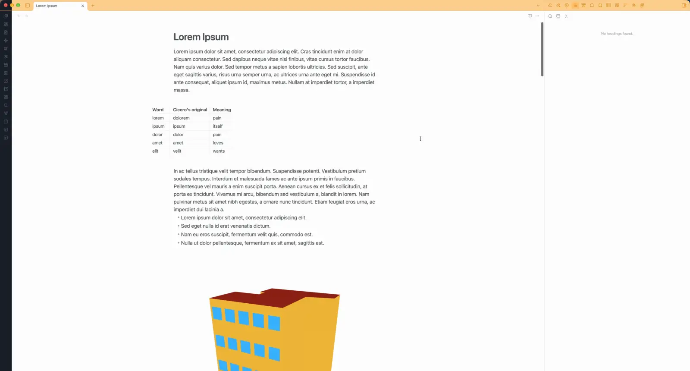

# Note Media Navigator

**A list of figures and tables for the note you are working on.**

Long notes collect figures, tables, PDFs and recordings, and finding one again means scrolling. Note Media Navigator lists everything the current note embeds in a sidebar, in the order it appears, each with a preview. Click a card to jump to that place in the note.

## What it lists

- **Images and SVG** embedded with `![[figure.png]]`, `` or an HTML `` tag, from the vault or the web.
- **PDFs, video and audio** embedded the same ways. A PDF card shows the first page, a video card the first frame, and audio a tile.
- **Tables:** Markdown pipe tables and HTML `<table>`s, previewed with their first six rows and five columns.

Code blocks, inline code, `%%` comments and the note's properties are skipped. A file embedded twice is listed twice.

## Usage

| Do this                              | How                                                                                       |
| ------------------------------------ | ----------------------------------------------------------------------------------------- |
| Open the pane                        | Ribbon icon **Open note media**, or the command **Note Media Navigator: Open note media** |
| Go to an item in the note            | Click its card                                                                            |
| Embed it in a note                   | Drag the card into a note, the same one or one in another tab or split                   |
| Open the file in a new tab           | Cmd-click (macOS), Ctrl-click or middle-click; a web address opens in the browser        |
| Open the file in a split             | Cmd-Option-click (macOS) or Ctrl-Alt-click                                                |
| Show the file in Finder or Explorer  | Option-click (macOS) or Alt-click                                                         |
| More actions                         | Right-click a card (press and hold on a phone)                                            |
| Show or hide one kind                | Click its chip: Images, SVG, PDF, Video, Audio or Tables                                  |
| Make the cards larger or smaller     | Move the **Thumbnail size** slider: 50% gives two columns, 25% four, 100% one             |

Cards of different heights stack into columns without gaps. Each card goes into the column that is shortest so far, so a card further down the pane always comes later in the note.

A dragged card drops an embed such as `![[figure.png]]` where you let go: a link to the file where it already is, so nothing is copied in the vault. The link follows your **Files and links** settings (wikilink or Markdown, shortest or relative path) for the note it lands in, and keeps a PDF page such as `#page=2`. Tables cannot be dragged.

The pane follows the note you last worked in and updates as you type. The pane opens when you turn the plugin on; afterwards Obsidian keeps it where you put it, and once closed it stays closed until you open it again. The chips and the thumbnail size are remembered.

## Compatibility

- Live Preview, Source mode and Reading view. In Reading view a click scrolls the note to the item.
- Desktop and mobile. Showing a file in Finder or Explorer and dragging cards into notes are desktop only.
- Embedded notes, Canvas files, drawings from other plugins and content other plugins generate while a note renders are not listed.
- Not detected: HTML media tags whose `src` spans several lines, and Markdown embeds whose address has an unescaped `)`.
- With some themes or PDF settings, a PDF card shows a blank page or an icon instead of the first page. The card still works.

## Privacy

The plugin makes no network requests of its own and sends nothing anywhere. Images and videos the note embeds from the web load in their cards, as they do in the note. PDFs from the web are not loaded; their card shows an icon.

## Installation

To install it by hand, download `main.js`, `manifest.json` and `styles.css` from the [latest release](https://github.com/adalach/obsidian-note-media-navigator/releases/latest) into `<vault>/.obsidian/plugins/note-media-navigator/` and turn it on under **Settings → Community plugins**. [BRAT](https://github.com/TfTHacker/obsidian42-brat) can install pre-releases from `adalach/obsidian-note-media-navigator`.

## Development

Building from source, the tests and the code layout are described in [DEVELOPMENT.md](DEVELOPMENT.md).

## License

[MIT](LICENSE) © Agata Dalach
